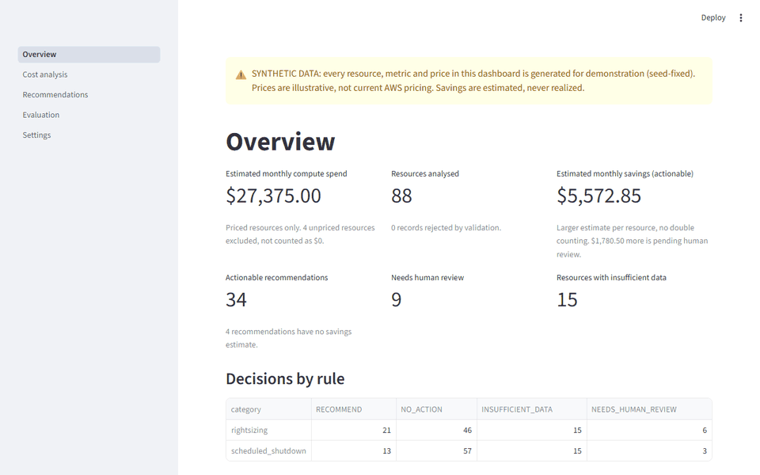
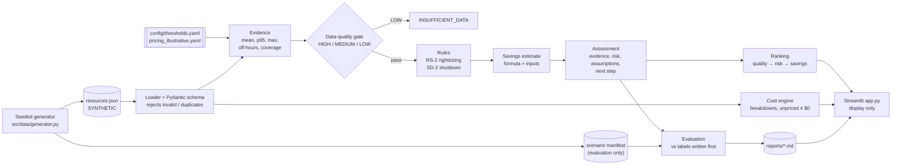
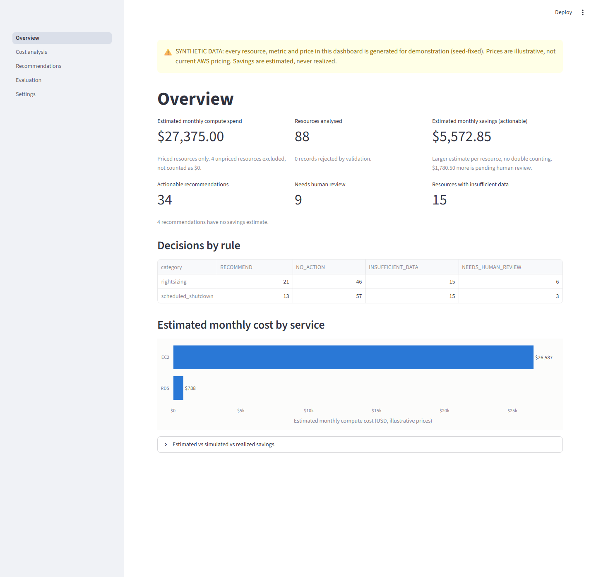
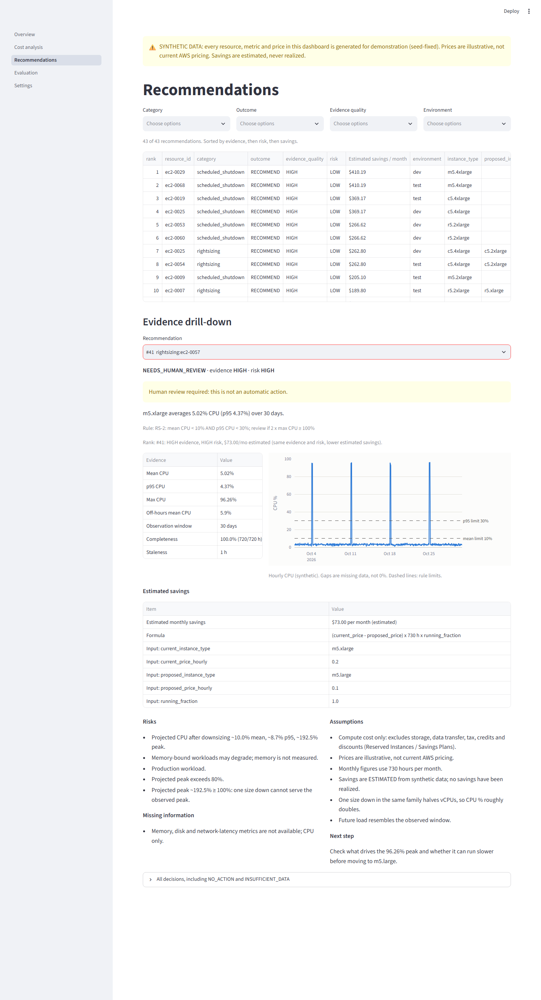

# AWS Cost Optimization Advisor

**Evidence-based, rule-based cloud cost analysis: it recommends rightsizing and off-hours
shutdowns only when the metrics justify it, says `INSUFFICIENT_DATA` when they don't, and
proves its rules with a label-first, pre-registered evaluation.**

[](https://github.com/sachinsingh9821/aws-cost-optimization-advisor/actions/workflows/ci.yml)
[](https://github.com/sachinsingh9821/aws-cost-optimization-advisor/actions/workflows/ci.yml)


> **SYNTHETIC DATA ONLY.** Every resource, metric and price is generated from a fixed seed.
> Prices are *illustrative, not current AWS pricing*. All savings are *estimated*; none are
> *realized*. The MVP makes zero AWS or network calls.



## What it does

For each compute resource it runs a **data-quality gate**, then two rules:

| Rule | Recommends when | Never |
|---|---|---|
| **Rightsizing** (one size down, same family) | ≥ 14 days of metrics, ≥ 90% complete, ≤ 48 h stale, **mean CPU < 10% and p95 CPU < 30%** | for critical resources (→ human review); when 2 × max CPU ≥ 100% (→ human review) |
| **Scheduled shutdown** (Mon–Fri 09:00–19:00 UTC) | non-prod **and** tagged `schedule_eligible` | for prod; by *inferring* eligibility; when off-hours CPU > 5% (→ human review) |

Every recommendation carries its evidence (mean, p95, max, coverage, staleness), the rule
that fired, an explicit `HIGH`/`MEDIUM`/`LOW` evidence grade, risks, assumptions, missing
information, an estimated saving **with its formula**, and a next step. A missing price
yields *"Cannot estimate with available data"*, never $0.

## Results

All numbers come from `python tasks.py evaluate`
([`reports/evaluation_report.md`](reports/evaluation_report.md); frozen v1:
[`reports/evaluation_report_v1.md`](reports/evaluation_report_v1.md)). They measure **rule
logic on synthetic scenarios**, not real-world accuracy.

| Set | Rules | Decisions | Rightsizing accuracy | Shutdown accuracy | Misses | Safety violations |
|---|---|---|---|---|---|---|
| Original (88 resources) | v1 | 176 | 0.977 (86/88) | 0.989 (87/88) | 3 | 0 |
| Original (88 resources) | v2 | 176 | 0.977 (86/88) | 0.989 (87/88) | 3 | 0 |
| Held-out (29 resources) | v1 | 58 | 0.724 (21/29) | 0.759 (22/29) | 15 | 0 |
| Held-out (29 resources) | v2 | 58 | **1.000 (29/29)** | **1.000 (29/29)** | **0** | 0 |

| Set | Rules | Rightsizing RECOMMEND P / R / F1 | Shutdown RECOMMEND P / R / F1 |
|---|---|---|---|
| Original | v1 | 0.955 / 0.955 / 0.955 | 0.933 / 1.000 / 0.966 |
| Original | v2 | **1.000** / 0.955 / 0.977 | **1.000** / 0.929 / 0.963 |
| Held-out | v1 | 0.467 / 1.000 / 0.636 | 0.500 / 1.000 / 0.667 |
| Held-out | v2 | 1.000 / 1.000 / 1.000 | 1.000 / 1.000 / 1.000 |

Also: savings arithmetic matched **13/13** hand-computed cases (agreement to 4 decimal
places); evidence-quality grades 88/88 correct.

**How to read this.** I wrote the scenarios, labels and rules, so the non-ambiguous cases
mostly check that the code does what its spec says:

| Subset | v1 | v2 |
|---|---|---|
| Non-ambiguous (80 resources, 160 decisions) | 160/160, i.e. **spec conformance** | 159/160 (one C2 over-trigger, below) |
| Ambiguous / boundary (8 resources, 16 decisions) | **13/16, the meaningful number** | 14/16 |

The ambiguous cases are where a threshold rule and a careful engineer can disagree. All
three v1 misses were **pre-registered** (predicted and committed before the evaluation
code existed). Two fixes (C1, C2) were then validated on a **held-out set committed
before the fix was coded**. The held-out set was written by the same author as the fix,
which is a stated limitation. v2 also introduced one predicted **over-trigger**, an idle
box with a 5.8% baseline sent to review, analysed in
[`docs/EVALUATION.md`](docs/EVALUATION.md).

## Quick start

Python 3.11+, in a virtual environment:

```bash
pip install -r requirements-dev.txt   # pinned deps
python tasks.py check                 # lint + tests (≥85% coverage gate) + evaluation report
python tasks.py app                   # dashboard on http://localhost:8501
```

`tasks.py` works on Windows without `make`. A thin `Makefile` wraps it. Other commands:
`python tasks.py data` regenerates the seeded data and labels; the bytes are identical
every time, and CI checks this.

## Architecture



| Path | Role |
|---|---|
| `src/schema.py` | Pydantic models: inputs (nullable metrics/prices) and the `Assessment` output |
| `src/data/` | deterministic generator (original + held-out sets), loader, validation |
| `src/rules/` | evidence, data-quality gate, rightsizing, shutdown |
| `src/savings/`, `src/cost/`, `src/ranking/` | estimates, cost breakdowns, lexicographic ranking |
| `src/evaluation/` | labels, metrics, v1/v2 report generation |
| `src/dashboard/` | view model + chart builders (all UI data shaping, tested) |
| `app.py` | Streamlit pages; no business logic |

Design rationale: [`docs/DESIGN.md`](docs/DESIGN.md) · formulas and data dictionary:
[`docs/CALCULATIONS_AND_DATA.md`](docs/CALCULATIONS_AND_DATA.md) · evaluation method and
miss analysis: [`docs/EVALUATION.md`](docs/EVALUATION.md) · security:
[`docs/SECURITY.md`](docs/SECURITY.md).

## Screenshots

| Overview | Evidence drill-down |
|---|---|
|  |  |

The drill-down shows the case that motivated change C1. CPU averages 5% and p95 is 4.4%,
but a Sunday batch peaks at 96%. One size down could not serve that peak, so v2 routes it
to human review instead of recommending it.

More: [recommendations](docs/screenshots/recommendations.png) ·
[cost analysis](docs/screenshots/cost_analysis.png) ·
[evaluation](docs/screenshots/evaluation.png).

## Limitations (honest)

- **Synthetic only.** No real AWS data has been used. Real-world precision and recall are unknown.
- **Same author** for scenarios, labels, rules *and* the held-out set. The evaluation shows
  the rules do what they are meant to; it cannot show they are the right rules.
- **Small, hand-designed sets:** 88 + 29 resources. Small classes give noisy per-class numbers.
- **CPU only.** Memory, disk and network are not measured, so downsizing a memory-bound
  workload could hurt. Every recommendation says so.
- **Illustrative prices.** Region-independent; compute only (no storage, data transfer,
  tax, credits, RIs/Savings Plans).
- **Absolute off-hours threshold.** C2 cannot tell an idle baseline from real work (one
  known over-trigger).
- **Fixed UTC schedule;** one-size-down within a family only.

## Roadmap

Implemented: everything above (MVP). Planned, in order:

1. **Live demo:** deploy to Streamlit Community Cloud (synthetic data only).
2. **Cost anomaly detection** on daily cost history (rolling baseline + z-score/IQR),
   kept separate from waste detection.
3. **Read-only AWS adapters** (Cost Explorer, CloudWatch) via boto3, tested with
   `botocore.Stubber`. Needs read-only IAM. Cost Explorer API calls are billed, so this
   will be documented before it's built. It will never silently fall back to synthetic data.
4. **"Explain this recommendation" (optional LLM):** the model receives only the
   structured `Assessment` JSON and writes a plain-English summary. It never computes or
   changes numbers, and a test asserts every number in its output appears in the input.
   Off by default; API key via env var.
5. *(C4)* Relative off-hours check to remove the known C2 over-trigger, validated on new
   pre-registered held-out cases.

## License

Not yet chosen.
